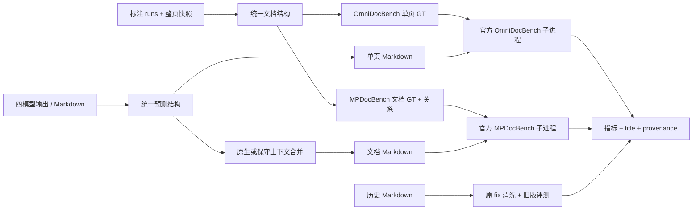

# 架构

| 模块 | 职责 |
| --- | --- |
| `schema.py` | 文档、页面、块，中间格式读写和基本验证 |
| `annotations.py` | 整页快照替换、坐标和 PDF 尺寸、跨页关系解析、审计 |
| `predictions.py` | 已有 pages/blocks、MinerU content list 和 Markdown 适配 |
| `unlimited_ocr2_parser.py` | Unlimited OCR2 原生 token 语法，保留页面和关系 |
| `markdown.py` | 表格转换、页面渲染、Ovis Markdown 解析 |
| `context.py` | 原生关系、可选保守边界推断、文档合并 |
| `charts.py` | 统一图表增强扩展，JSON provider／人工确认 sidecar |
| `exporters.py` | 两种官方 GT 格式及两种预测格式 |
| `metrics.py` | 历史 title、指标提取、明确命名的汇总 |
| `backends/worker.py` | 进程内注册及调用上游数据集／指标类 |
| `backends/runner.py` | 覆盖率、配置、隔离运行、日志和报告 |
| `backends/exact_teds.py` | 复用上游树结构和代价的精确动态规划，避免大表格长时间停滞 |
| `benchmark.py` | 批量评分、状态记录及 CSV／Markdown 汇总 |
| `compatibility/cleaning.py` | 本工程维护的图片替换、details 清洗及独立开关 |
| `compatibility/engine/` | 吸收的历史匹配与指标最小实现，保留来源许可与复现约束 |
| `profiles.py` | standard／legacy 的固定默认值与显式覆盖规则 |
| `pipeline.py` | 按固定模式完成数据准备、评分与报告 |
| `quality.py` | 检查结构完整性、关系确认记录及旧新 PDF／页面重复 |
| `repetition.py` | 只读检查原始输出与评测 Markdown 的长连续重复，保存原文证据 |
| `history.py` | 读取历史 xlsx，对已完成的跑分逐列比较 |
| `cli.py` | 参数解析和工作流编排 |

新适配器应只负责把模型原始输出映射为 `Document`，不在导出器里增加模型专属补丁。新后处理策略放在上下文或图表模块，并通过独立配置输出到新目录，保留原始预测和审计记录。

两个评测器存在同名模块 `dataset`、`metrics`、`registry`；必须运行在不同子进程，不能在主进程同时 import。所有结果写在任务自己的 `runtime/result/`。关闭 CDM 时只屏蔽可选公式渲染模块的导入，不改变已启用指标的实现。
